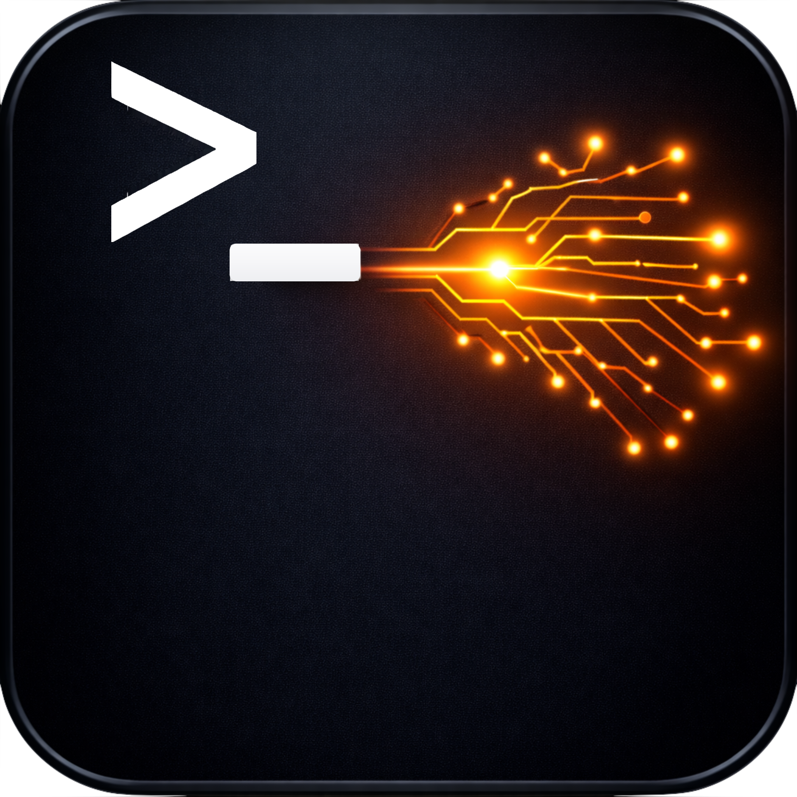
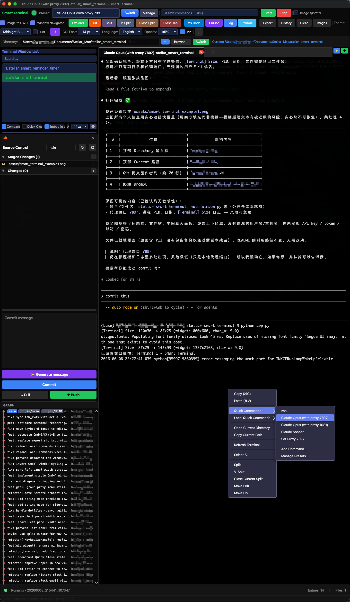
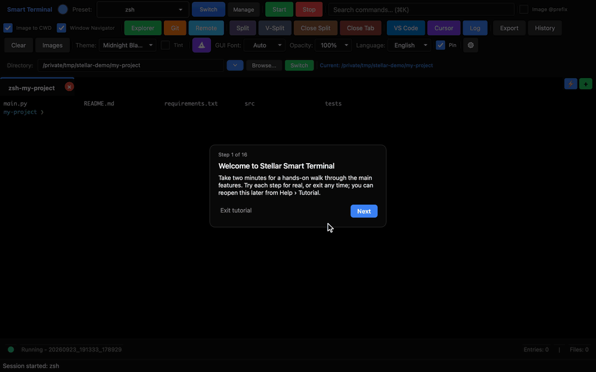
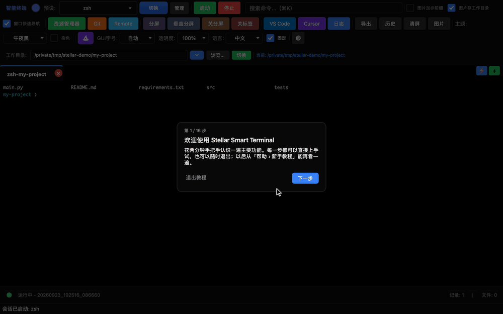
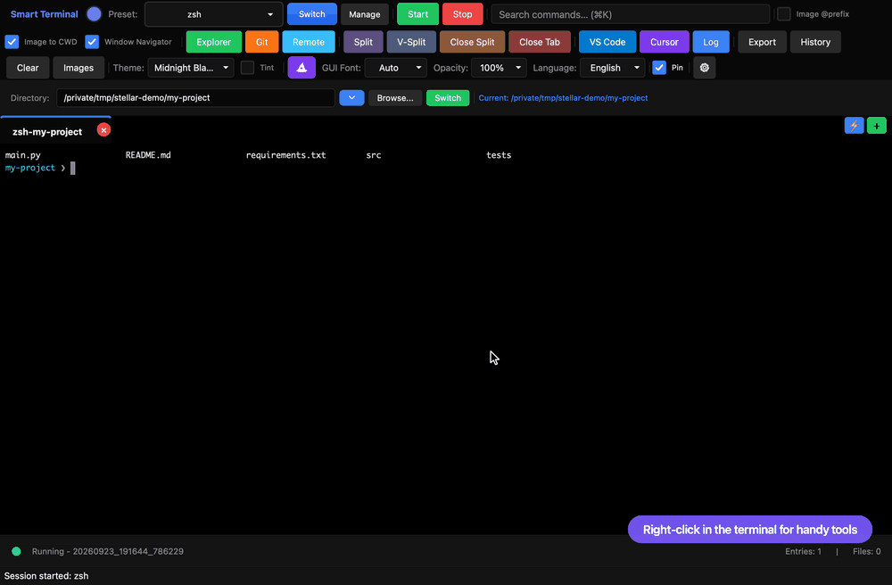
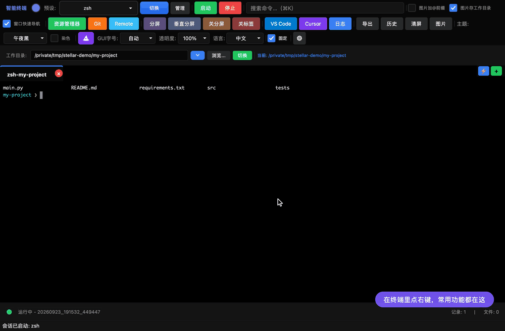

# Stellar Smart Terminal

English | [简体中文](README.zh-CN.md)

A PyQt6-based smart terminal with file explorer, Git GUI, LLM proxy, and VS Code extension browser.



## Screenshot



> Multi-pane layout: file explorer / Git, code editor, and multi-tab terminal in one window.

## Tutorial

An interactive tour pops up on first launch, walking you through Quick Launch (⚡), split panes, side panels, the command palette and more. Replay it anytime from Help › Tutorial.



<details><summary>Chinese version</summary>



</details>

### Terminal right-click menu

Plenty of handy tools live in the terminal's right-click menu: run presets in one click, per-project local quick commands, scrollback search, copy the current path, split panes, scroll speed and more.



<details><summary>Chinese version</summary>



</details>

## Features

- **Multi-tab Terminal** — session management
- **File Explorer & Editor**
- **Git GUI** — stage, commit, push, pull, diff, branch
- **LLM Proxy** — OpenAI-compatible
- **VS Code Extensions**
- **i18n** — English / Chinese

## Download

No Python required — grab a build from the [**Releases**](https://github.com/StellarStar255/stellar_smart_terminal/releases/latest) page.

1. Download `Stellar-Smart-Terminal-vX.Y.Z-macOS-arm64.dmg` (recommended; a zip is also available).
2. Open the DMG and drag `Stellar Smart Terminal.app` into the `Applications` folder.
3. Double-click to open. Since v1.16.4, macOS builds are Developer ID signed and notarized by Apple.

   <details><summary>Only for old versions (≤ v1.16.3)</summary>

   Older unsigned builds may be blocked on first launch — go to **System Settings → Privacy & Security** and click **Open Anyway**, or run:

   ```bash
   xattr -cr "/Applications/Stellar Smart Terminal.app"
   ```

   </details>

> Currently Apple Silicon (arm64) only.

## Quick Start (from source)

```bash
pip install -r requirements.txt
python app.py
```

## Requirements

- Python 3.10+
- PyQt6 >= 6.5.0
- pyte >= 0.8.0

## Troubleshooting

```shell
pip uninstall PyQt6 PyQt6-Qt6 PyQt6-sip -y
pip install PyQt6==6.7.1 PyQt6-Qt6==6.7.1 --no-cache-dir
```

## Guides

The following guides are written in Chinese.

- [Claude Code click-to-focus notifications (macOS)](docs/claude-code-notifications.md) — Configure a Stop hook so clicking a notification focuses the corresponding Smart Terminal window.
- [Packaging & Release](docs/PACKAGING.md) — The full workflow from packaging with `./build.sh` to publishing a GitHub Release.
- [macOS permissions & responsible process](docs/macos-permissions.md) — Troubleshoot microphone/camera crashes, configure Info.plist usage descriptions, and grant permissions that require manual approval.
- [Troubleshooting: PowerShell + proxy claude login](docs/troubleshooting-powershell-proxy-claude-login.md) — Set proxies on Windows with `$env:http_proxy = "..."` so the claude child process receives them.

## Build

Package as a standalone app (onedir mode, no Python required).

```bash
# macOS — creates dist/Stellar Smart Terminal.app and a drag-to-install .dmg
./build.sh
open "dist/Stellar Smart Terminal.app"
```

```bat
:: Windows — creates dist\StellarSmartTerminal\StellarSmartTerminal.exe
build.bat
```

> The script creates an isolated `.venv-build` venv, installs dependencies and PyInstaller, and (on macOS) generates the `.icns` icon from `assets/smart_terminal.png` and a drag-to-install DMG. See `smart_terminal.spec` for configuration.
>
> For the full release workflow (version bump, tag, GitHub Release), see [docs/PACKAGING.md](docs/PACKAGING.md).

## License

[MIT](LICENSE)
