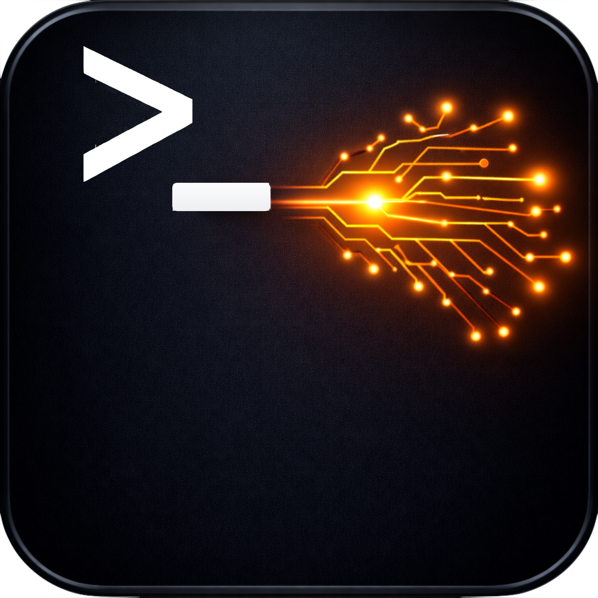
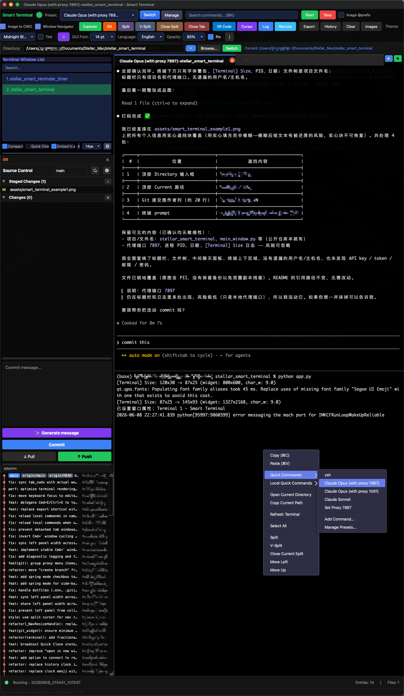
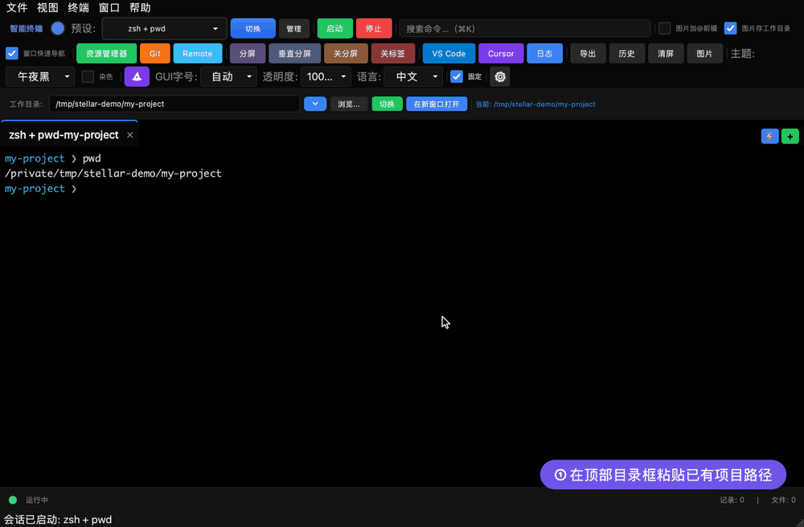
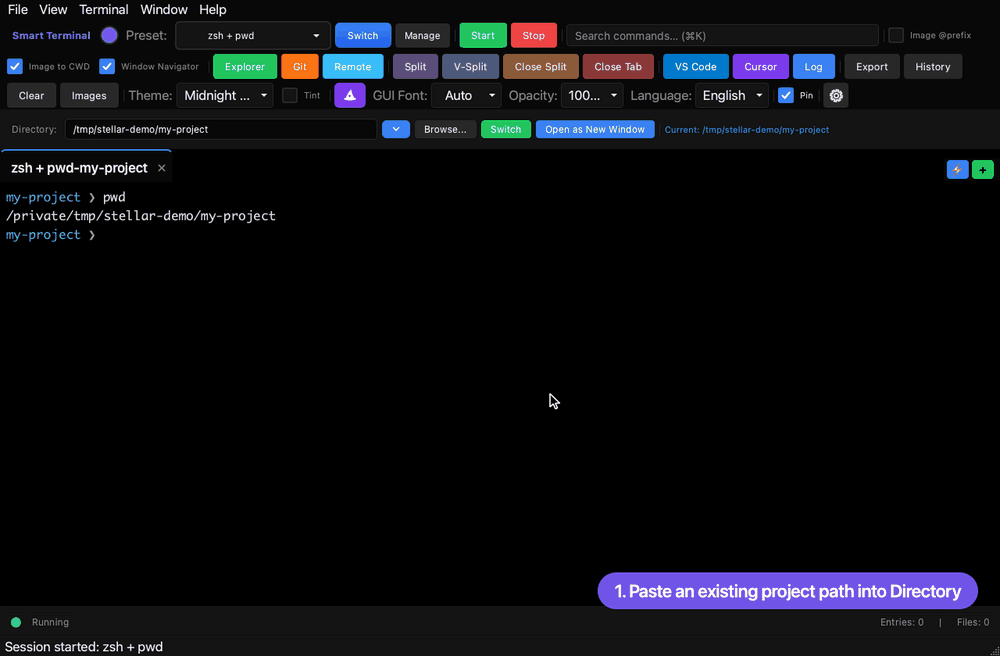
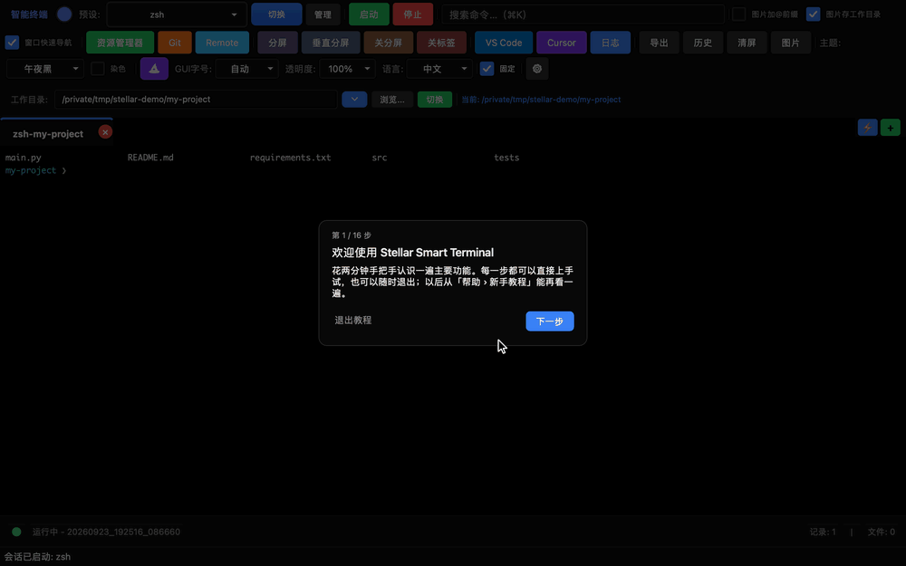
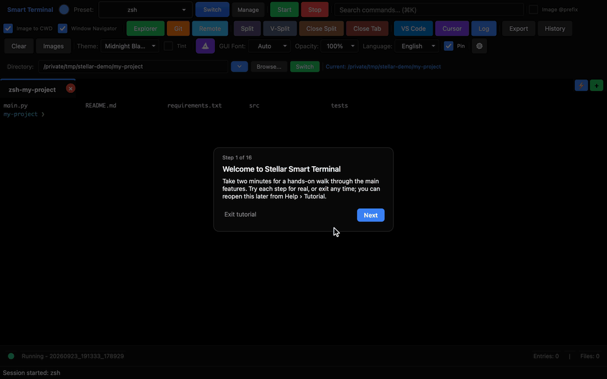
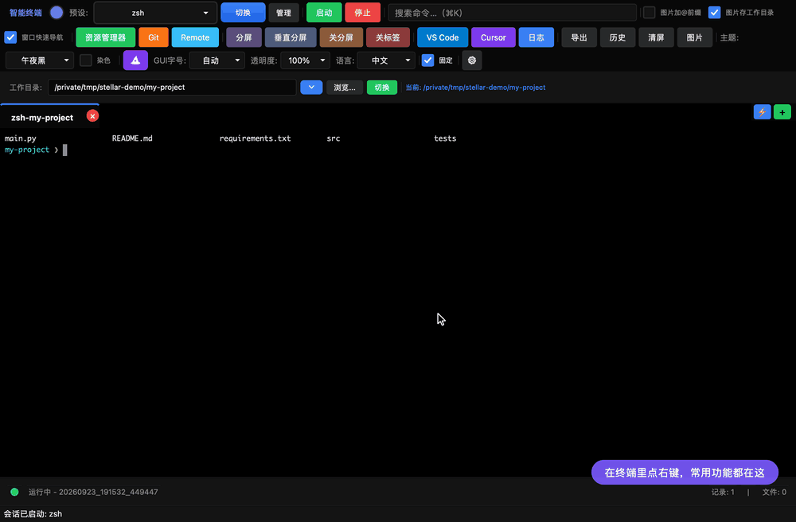
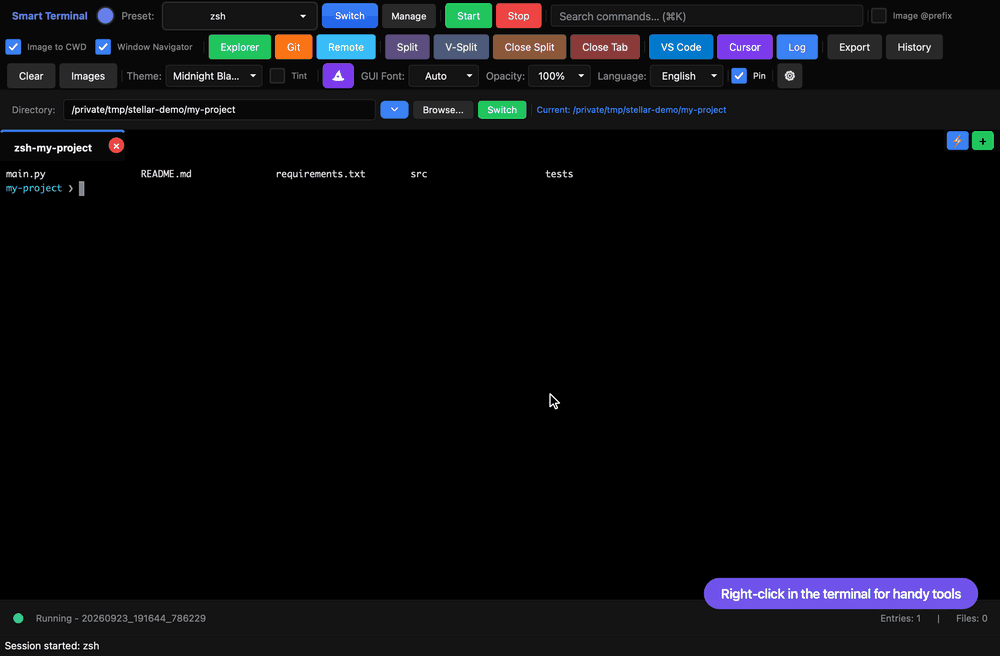

# Stellar Smart Terminal

[English](README.md) | 简体中文

基于 PyQt6 的智能终端，集成文件管理、Git GUI、LLM 代理和 VS Code 扩展浏览。

最新版本：[v1.35.31](docs/releases/v1.35.31.md)，修复 SSH 端口转发停止后重新启动时误报端口被占用的问题。

A PyQt6-based smart terminal with file explorer, Git GUI, LLM proxy, and VS Code extension browser.



## Screenshot / 界面预览



> 多面板布局：文件管理 / Git、代码编辑器与多标签终端集成在一个窗口中。
> Multi-pane layout: file explorer / Git, code editor, and multi-tab terminal in one window.

## 粘贴路径，在新窗口打开项目 / Open a project in a new window

在顶部 **Directory / 目录** 输入框粘贴**已有文件夹路径**，点击 **Open as New Window / 在新窗口打开**，即可打开独立的项目窗口，并自动运行当前选中的命令预设，比如 Codex、Claude Code。路径会自动记入最近目录，重启后仍保留；下次从目录历史选取，再点该按钮即可重新打开。

Paste an existing folder path into Directory and click **Open as New Window** to launch a separate project window with your selected preset. The path is saved in recent directories across restarts for quick reopening.

也可以点击 **⚡**，在弹窗搜索框里**直接粘贴长路径**，按 **Shift+Enter** 在新窗口打开；只按 **Enter** 则新建标签。下面的演示放大了路径输入框，并同时展示原窗口和新窗口，方便看清完整操作和结果。

You can also paste a long path directly into **⚡** and press **Shift+Enter** for a new window, or **Enter** for a new tab. The demo enlarges the input and shows both windows.



<details><summary>English version</summary>



</details>

### 用 ⚡ 新建标签 / Quick Launch in a tab

先选好命令预设，点击标签栏右端的 **⚡**，粘贴一个**已存在的文件夹路径**，按 **Enter**：立即在该目录新建终端标签，并自动运行当前预设，比如你配置好的 Codex、Claude Code 启动命令。路径会记入最近目录，下次直接点选；其他标签保留各自的工作目录。

例如 `/path/to/project`、`~/projects/my-app`，Windows 可用 `C:\projects\my-app`。输入路径后按 **Shift+Enter**，或按住 **Shift 点击**最近目录，即可在新窗口打开。这是把已有文件夹作为项目终端打开，不会新建文件夹或初始化仓库。

Choose a preset, click **⚡**, paste an existing folder path, and press **Enter** to open a new tab there and run the preset automatically. The path is saved in recent directories; Shift-click an entry to open it in a new window. Existing tabs keep their working directories.

## Tutorial / 新手教程

首次启动会弹出互动教程，手把手带你认识 ⚡ 快速切目录、分屏、侧栏、命令面板等功能；之后可从「帮助 › 新手教程」随时重看。

An interactive tour pops up on first launch, walking you through Quick Launch (⚡), split panes, side panels, the command palette and more. Replay it anytime from Help › Tutorial.



<details><summary>English version</summary>



</details>

### 终端右键菜单 / Terminal right-click menu

很多好用的功能藏在终端右键里：快速命令一键执行预设、跟着项目目录走的本地快速命令、搜索回滚历史、复制当前路径、分屏、调滚动灵敏度……

Plenty of handy tools live in the terminal's right-click menu: run presets in one click, per-project local quick commands, scrollback search, copy the current path, split panes, scroll speed and more.



<details><summary>English version</summary>



</details>

## Features / 功能

- **Multi-tab Terminal / 多标签终端** — session management / 会话管理
- **Project Quick Launch (⚡) / 项目快速启动** — 粘贴文件夹路径，自动新建标签并运行预设；最近目录一键复用
- **File Explorer & Editor / 文件管理与编辑器**
- **Git GUI** — stage, commit, push, pull, diff, branch
- **LLM Proxy / LLM 代理** — OpenAI-compatible / 兼容 OpenAI 接口
- **VS Code Extensions / VS Code 扩展浏览**
- **i18n** — English / 中文

### 终端录制与导出 / Terminal recordings and export

自动录制默认关闭。需要记录时，在 **History → 开始录制当前终端**（也可从「文件」菜单进入）手动开启，仅记录此刻起选定终端的输入输出；切换标签不改变目标。可随时停止并保存；目标终端退出、关闭或移到其他窗口时结束录制，重启应用不会自动开启。旧记录仍可在 History 查看和导出。

**Export** 直接导出当前终端已保留的屏幕和回滚文本，无需开启录制，无法找回已清除或丢弃的内容。Codex 等动态界面的完整对话请使用工具自身的会话历史；原始终端录制可能出现重复或错位。

Automatic recording is off. Start it manually from History or File to capture one selected terminal from that point onward. Export saves the current terminal’s retained screen and scrollback text. Use the tool’s own session history for complete Codex conversations; raw recordings may contain repeated or misplaced text.

### SSH 端口转发组合 / SSH port-forwarding groups

在主机的「端口转发」窗口勾选多条规则，点击「另存组合…」命名保存。之后选择组合，点击「启动勾选端口」或「停止勾选端口」即可批量操作，不影响未勾选的端口；切换组合本身不会启停端口。可拖拽规则调整顺序，组合和顺序分别按主机保存。绿色圆点表示运行状态，复选框表示组合成员。

Check rules in a host’s Port Forwarding dialog and save a named group. Select it to start or stop checked ports together; selecting a group does not change running ports. Drag rules to reorder. Groups and order are saved per host.

打开窗口或点击“刷新状态”时，会核对当前主连接和本机监听。成功的启停记录与该主连接绑定，应用重开后可恢复状态；无法确认的规则显示“状态待确认”。远程转发依据上述记录判断，SSH 不提供通用的远程监听列表查询。“重启”会先停止所选规则，停止失败则不继续启动；操作期间禁用重复操作，列表显示进度，失败原因可在提示中查看。恢复转发只撤销本应用在当前主连接上记录的同一条规则，不结束其他 SSH 进程，也不重建主连接。

Open the dialog or use Refresh to check the current master and local listeners. Records tied to that master restore status after reopening the app; unverifiable rules show Unknown status. Remote forwards rely on these records. Restart stops the selected rule before starting it and stops if cancellation fails. Controls are disabled during operations. Recovery never kills another SSH process or rebuilds the master.

窗口显示期间每 15 秒在后台检查状态，不自动重连或启停转发。后台检查不禁用界面，不重叠执行；用户操作后会丢弃过期结果。后台错误显示在规则状态和悬浮提示中，不反复弹窗。坏规则单独显示“规则无效”和错误原因，不影响其他规则的检查与启动。SSH 明确确认规则已不存在时，停止视为成功，重启或删除可继续；其他撤销错误仍会中止操作。

While visible, the dialog checks status in the background every 15 seconds without reconnecting or changing forwards. Controls stay available, checks never overlap, and stale results are discarded. Background errors appear inline without repeated popups. Invalid rules do not block healthy ones. An explicit confirmation that a rule is already absent counts as a successful stop; other errors still abort the operation.

选中规则后点击“测试连通性”，分别查看转发状态、监听连接和目标 TCP 的检测结果。本地转发从 SSH 主机检测目标，远程转发从本机检测目标；SOCKS5 需输入明确的“主机:端口”，再测试 SOCKS5 CONNECT 路径。本地/远程转发的监听与目标分别检测，TCP 可连接不代表业务或登录正常。检测复用已有主连接，不启停转发、不重新认证；远端无法执行检测时显示“无法确认”。

Select a rule and use Test Connection to check its state, listener, and destination TCP separately. Local forwards check the destination from the SSH host; remote forwards check it locally. SOCKS5 requires an explicit host:port and tests the CONNECT path. TCP reachability does not establish application health. The existing master is reused without starting/stopping forwards or authenticating again; unavailable remote probes are reported as unverified.

## Download / 下载安装

无需安装 Python，从 [**Releases**](https://github.com/StellarStar255/stellar_smart_terminal/releases/latest) 下载即可使用。
No Python required — grab a build from the [**Releases**](https://github.com/StellarStar255/stellar_smart_terminal/releases/latest) page.

1. 下载 `Stellar-Smart-Terminal-vX.Y.Z-macOS-arm64.dmg`（推荐；也提供 zip）
   Download the `.dmg` (recommended; a zip is also available)
2. 打开 DMG，把 `Stellar Smart Terminal.app` 拖进 `Applications` 文件夹
   Open the DMG and drag the app into the `Applications` folder
3. 双击打开即可——自 v1.16.4 起，macOS 版本已使用 Developer ID 签名并通过 Apple 公证，不会再被 Gatekeeper 拦截。
   Double-click to open — since v1.16.4 the macOS builds are Developer ID signed and notarized by Apple, so Gatekeeper opens them without any prompt.

   <details><summary>仅旧版本（≤ v1.16.3）需要 / Only for old versions (≤ v1.16.3)</summary>

   旧版未签名，首次启动若提示 **"Not Opened"**：到 **系统设置 → 隐私与安全性** 底部点 **仍要打开 (Open Anyway)**，或在终端执行：
   Older unsigned builds may be blocked on first launch — go to **System Settings → Privacy & Security** and click **Open Anyway**, or run:

   ```bash
   xattr -cr "/Applications/Stellar Smart Terminal.app"
   ```

   </details>

> 目前仅提供 Apple Silicon (arm64) 构建。
> Currently Apple Silicon (arm64) only.

## Quick Start (from source) / 源码运行

```bash
pip install -r requirements.txt
python app.py
```

## Requirements / 依赖

- Python 3.10+
- PyQt6 >= 6.5.0
- pyte >= 0.8.0

## Troubleshooting / 故障排除
```shell
pip uninstall PyQt6 PyQt6-Qt6 PyQt6-sip -y
pip install PyQt6==6.7.1 PyQt6-Qt6==6.7.1 --no-cache-dir
```

## Guides / 指南

- [Claude Code 通知点击跳转 / Click-to-focus notifications (macOS)](docs/claude-code-notifications.md) — Stop hook 配置，点击通知直接跳回对应 Smart Terminal 窗口
- [打包与发布 / Packaging & Release](docs/PACKAGING.md) — 从 `./build.sh` 打包到 GitHub Release 发版的完整流程
- [macOS 权限与责任进程 / macOS permissions & responsible process](docs/macos-permissions.md) — 为何终端里的程序用麦克风/摄像头会闪退，Info.plist 用途声明与四类需手动授权的权限
- [排障：PowerShell + 代理下 claude login 失败 / PowerShell + proxy claude login](docs/troubleshooting-powershell-proxy-claude-login.md) — Windows 下代理要用 `$env:http_proxy = "..."` 而非 `set`，否则子进程 claude 拿不到代理导致 login 失败

## Build / 打包

打包为独立应用（onedir 模式，无需安装 Python）。
Package as a standalone app (onedir mode, no Python required).

```bash
# macOS — 产出 dist/Stellar Smart Terminal.app 和拖拽安装的 .dmg
./build.sh
open "dist/Stellar Smart Terminal.app"
```

```bat
:: Windows — 产出 dist\StellarSmartTerminal\StellarSmartTerminal.exe
build.bat
```

> 脚本会自动创建独立虚拟环境 `.venv-build`、安装依赖与 PyInstaller，macOS 下还会从 `assets/smart_terminal.png` 生成 `.icns` 图标并打出 DMG。配置见 `smart_terminal.spec`。
> The script creates an isolated `.venv-build` venv, installs dependencies + PyInstaller, and (on macOS) generates the `.icns` icon from `assets/smart_terminal.png` and a drag-to-install DMG. See `smart_terminal.spec` for configuration.
>
> 完整的版本发布流程（版本号、tag、GitHub Release）见 [docs/PACKAGING.md](docs/PACKAGING.md)。
> For the full release workflow (version bump, tag, GitHub Release), see [docs/PACKAGING.md](docs/PACKAGING.md).

## License / 许可

[MIT](LICENSE)
